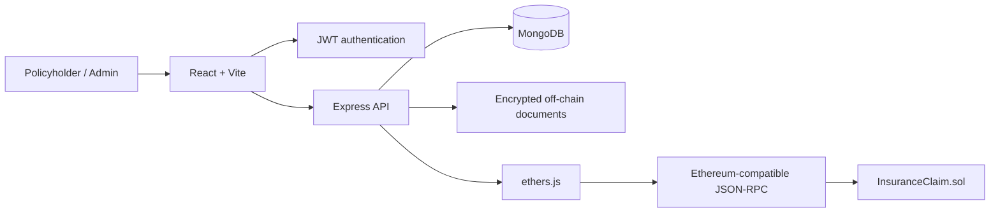
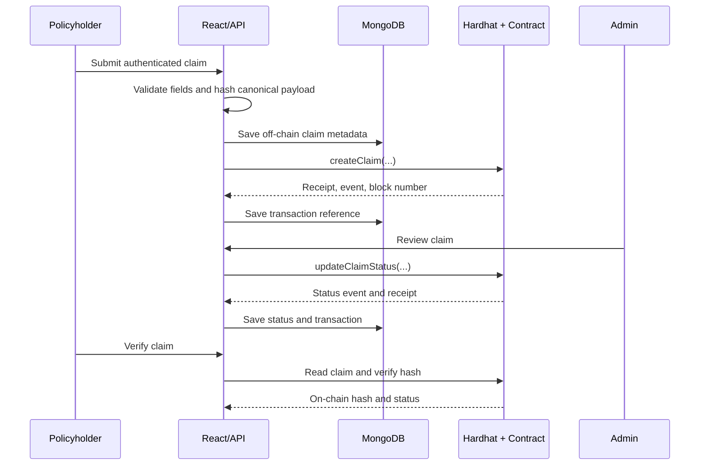

# Blockchain-Based Insurance Claim Management System

Slide-ready presentation content. Replace bracketed team details and insert screenshots captured from the running application; no transaction values should be invented.

## 1. Title

- **Project:** Blockchain-Based Insurance Claim Management System
- **Team:** [Names and roll numbers]
- **Institution:** [College / department]
- **Guide:** [Faculty name]

## 2. Problem Statement

Insurance claim decisions can be difficult to audit because records are distributed across policyholders, officers, and internal systems. A participant may not be able to prove which claim data was reviewed or when a decision was made.

## 3. Objectives

- Record a tamper-evident fingerprint for each claim.
- Restrict claim review actions to authorized administrators.
- Preserve an auditable status history and transaction references.
- Keep personal and document data off-chain.
- Demonstrate deployment, transactions, verification, and error handling on a local Ethereum-compatible network.

## 4. Proposed Solution

The React application calls an authenticated Express API. MongoDB stores application data and encrypted documents. The API uses ethers.js and an operator wallet to write only the claim reference, hash, amount, and status history to the `InsuranceClaim` Solidity contract running on Hardhat.

## 5. Why Blockchain?

- Append-only transaction history supports independent verification.
- Smart-contract access control makes review permissions explicit.
- Hashes prove integrity without publishing confidential claim contents.

**Limitations:** the prototype uses a local chain and server-managed development key; blockchain records do not prove that an uploaded document is truthful, and payments are simulated.

## 6. Architecture

## 7. Technology Stack

- React, Vite, Axios
- Express.js, MongoDB, Mongoose, JWT
- Solidity 0.8.24, Hardhat, ethers.js
- Local Hardhat node; optional Ethereum testnet deployment

## 8. Smart Contract Design

- `createClaim`: authorized administrator/operator records a new claim.
- `updateClaimStatus`: authorized administrator moves `PENDING -> UNDER_REVIEW -> APPROVED/REJECTED`.
- `getClaim`: reads the current on-chain record.
- `getClaimHistory`: reads immutable status history.
- `verifyClaimHash`: compares an application hash with the stored hash.
- Events: `ClaimCreated`, `ClaimStatusUpdated`, `AdminAuthorizationUpdated`.

## 9. End-to-End Workflow

## 10. On-Chain vs Off-Chain Data

**On-chain:** claim ID, policy ID, claimant reference, amount, claim-data hash, status, timestamps, actors, and status actions.

**Off-chain:** names, account credentials, descriptions, policy records, uploaded evidence, remarks, notifications, and MongoDB indexes. The contract never receives personal documents or medical records.

## 11. Security

- JWT authentication and server-side role checks.
- Contract owner controls administrator authorization.
- Contract rejects duplicate IDs, zero hashes, missing inputs, unauthorized writers, and invalid transitions.
- Uploads are validated and encrypted with AES-256-GCM.
- Secrets and private keys are placeholders in `.env.example` only.
- Development payments are explicitly simulated and do not collect bank credentials.

## 12. Demonstration Evidence

Insert screenshots captured during the live run:

1. Hardhat node and deployment output.
2. Claim submission response showing transaction hash and block number.
3. Admin review screen and status transaction.
4. Verification screen showing database hash, blockchain hash, block number, and `VERIFIED`.
5. Hardhat test output.

## 13. Test Cases

| Test case | Expected result | Actual result |
|---|---|---|
| Contract deployment | Owner is authorized | Record after running tests |
| Claim creation | Event and pending record | Record after running tests |
| Duplicate claim | Reverted | Record after running tests |
| Unauthorized write | Reverted | Record after running tests |
| Invalid status transition | Reverted | Record after running tests |
| Approval/rejection | Valid transition and event | Record after running tests |
| Hash verification | Matching true, tampered false | Record after running tests |
| Receipt verification | Hash and block are persisted | Record during demo |

## 14. Limitations and Future Scope

- Use audited key custody and a persistent RPC in production.
- Add wallet signature/user-wallet binding for decentralized administration.
- Add independent document notarization and stronger identity verification.
- Integrate a regulated payment provider only after compliance review.

## 15. Conclusion

The prototype demonstrates a complete, testable insurance-claim workflow where MongoDB provides practical application storage and Ethereum-compatible smart-contract records provide tamper-evident claim integrity and decision history.
