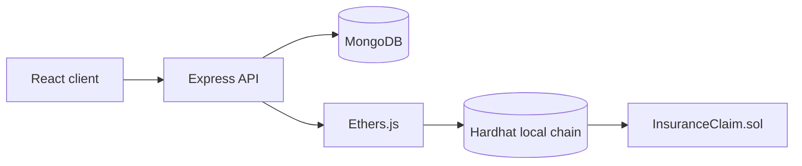
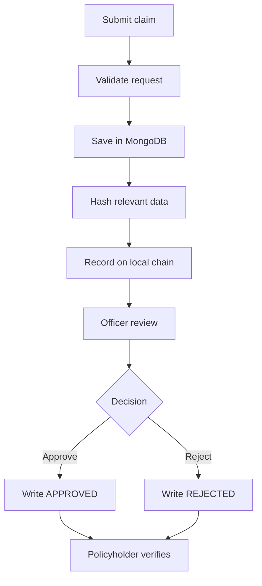

# Blockchain-Based Insurance Claim Management System

Academic mini-project demonstrating how a local Ethereum-compatible blockchain can make insurance claim decisions traceable and tamper-evident.

> Educational prototype only. It does not process real money or production-sensitive insurance documents.

## Abstract

Application data is stored in MongoDB for practical querying, while a compact claim fingerprint and status history are recorded on a local Hardhat blockchain. The Express API uses ethers.js to write and verify those records. The React interface provides policyholder and insurance-officer workflows.

## Architecture



MongoDB stores profiles, policies, descriptions, and application metadata. The contract stores claim ID, policy ID, claimant reference, amount, hash, status, timestamps, and status history. Large documents are not stored on-chain.

## Features

- JWT registration and login
- Policyholder and admin roles
- Policy and claim management
- Claim-data hash generation
- Local blockchain claim creation
- Officer approval and rejection
- Immutable status history
- Blockchain hash verification
- Transaction and block metadata
- Responsive dashboards
- Simulated settlement methods for approved claims
- Encrypted PDF/JPG/PNG claim-document uploads
- Configurable email reminders for pending claims and unpaid approved claims
- Indian insurance marketplace with Health, Motor, Personal Accident, Life, Home, Travel, and Crop products
- Simulated purchase payments using UPI, bank transfer, or card labels
- Admin purchase ledger showing which policyholder bought each policy

## Project structure

```text
insurance-blockchain/
├── client/       React + Vite frontend
├── server/       Express + MongoDB API
├── blockchain/   Solidity contract + Hardhat tests
├── .env.example
└── README.md
```

## Prerequisites

- Node.js 20 or newer
- npm
- MongoDB Community Server running locally
- No wallet, paid API, or real cryptocurrency

## Installation

```powershell
Set-Location -LiteralPath 'C:\Users\MAHEK PAHUJA\Desktop\BlockChain Insurance Claim\insurance-blockchain'
npm install
Copy-Item .env.example .env
```

Set `MONGODB_URI`, `JWT_SECRET`, `BLOCKCHAIN_RPC_URL`, `BLOCKCHAIN_PRIVATE_KEY`, and `CONTRACT_ADDRESS` in `.env`.

## Run locally

Use separate terminals.

### Local blockchain

```powershell
Set-Location -LiteralPath 'C:\Users\MAHEK PAHUJA\Desktop\BlockChain Insurance Claim\insurance-blockchain\blockchain'
npm run node
```

Copy a private key printed by Hardhat into `.env`, then deploy:

```powershell
npm run compile
npm run deploy
```

Copy the deployment address into `CONTRACT_ADDRESS`.

Keep the Hardhat node terminal running while using claims. If the node is stopped, or if `BLOCKCHAIN_PRIVATE_KEY` or `CONTRACT_ADDRESS` still contains a placeholder, claim submission will be rejected with a clear blockchain setup message.

### Accounts and data

No demo credentials or seed records are included. Register a policyholder account through the application. Administrator accounts must be provisioned through a secure operator workflow; never commit credentials to source control.

### Administrator access

Set these values only in the server's private `.env` file:

```env
ADMIN_EMAIL=your-admin-email
ADMIN_PASSWORD=your-long-admin-password
```

On the first administrator sign-in, the account is created with a bcrypt password hash. The login page's **Administrator** option does not grant privileges by itself; the server still requires the configured credentials and `ADMIN` role. Restart the API after changing these values.

### API and frontend

```powershell
npm run start --workspace server
```

In another terminal:

```powershell
npm run dev --workspace client
```

Open `http://localhost:5173`.

## API overview

```text
POST /api/auth/register
POST /api/auth/login
GET  /api/policies
POST /api/policies
GET  /api/policies/catalog
POST /api/policies/catalog
POST /api/policies/catalog/:productId/purchase
GET  /api/policies/purchases
GET  /api/claims
POST /api/claims
GET  /api/claims/:id
PUT  /api/claims/:id/status
GET  /api/claims/:id/history
GET  /api/claims/:id/verify
PUT  /api/claims/:id/payment
GET  /api/documents/claims/:id
POST /api/documents/claims/:id
GET  /api/documents/claims/:id/:documentId
GET  /api/blockchain/transaction/:hash
```

## Claim lifecycle



## Requirement compliance checklist

| College requirement | Evidence in this repository |
|---|---|
| Real-world problem and objectives | Abstract, problem context, objectives, benefits, and limitations above |
| Architecture and workflow | Mermaid architecture and lifecycle diagrams; [PRESENTATION.md](./PRESENTATION.md) has the sequence diagram |
| Working Ethereum prototype | `blockchain/contracts/InsuranceClaim.sol`, Hardhat configuration, deployment script, and ethers.js service |
| Transaction demonstration | Claim creation/status APIs persist transaction hash and block number; verification reads the deployed contract |
| Submission preparation | Test suite, security notes, setup commands, checklist, and slide-ready [PRESENTATION.md](./PRESENTATION.md) |

### Access-control and status rules

The API requires a JWT for all claim operations and checks the authenticated MongoDB role for administrator review. The contract independently authorizes the operator wallet and permits only `PENDING -> UNDER_REVIEW -> APPROVED` or `PENDING -> UNDER_REVIEW -> REJECTED`. Duplicate claim IDs, empty identifiers, zero hashes, missing actions, unauthorized writers, and terminal-state changes revert on-chain.

### Transaction evidence

`POST /api/claims` waits for the `ClaimCreated` transaction receipt before returning. `PUT /api/claims/:id/status` does the same for `ClaimStatusUpdated`. Both responses contain the claim’s `transactionHash` and `blockNumber`. `GET /api/claims/:id/verify` reads the on-chain claim and returns separate `databaseHash`, `blockchainHash`, and `blockchainStatus` values; it does not treat the database value as proof of the blockchain value.

### Audit status

- **Working:** Solidity compilation/tests, local deployment script, ethers.js writes/reads, JWT role checks, MongoDB persistence, encrypted uploads, client production build.
- **Partially demonstrated:** live API-to-chain integration requires MongoDB, a running Hardhat node, a deployment, and private local environment values.
- **Not production-ready:** local development key custody, local chain persistence, simulated payments, and unverified external uploads.
- **Baseline validation note:** the current server test harness may fail before tests run if an existing MongoDB connection is active; this is reported rather than presented as a passing integration result.

## Testing

```powershell
Set-Location -LiteralPath 'C:\Users\MAHEK PAHUJA\Desktop\BlockChain Insurance Claim\insurance-blockchain'
npm test --workspace blockchain
npm test --workspace server
npm run build --workspace client
```

The contract tests cover deployment, events, claim creation, duplicate prevention, invalid inputs, authorization, valid and invalid status transitions, history, and hash verification. The server suite covers authentication, role protection, request validation, documents, simulated payments, and policy flows.

## Live demonstration script

1. Start MongoDB: `mongod --dbpath C:\data\db` (or start the MongoDB Windows service).
2. In terminal 1, run `Set-Location -LiteralPath 'C:\Users\MAHEK PAHUJA\Desktop\BlockChain Insurance Claim\insurance-blockchain\blockchain'; npm run node`.
3. Copy one printed Hardhat private key into `server\.env` as `BLOCKCHAIN_PRIVATE_KEY`.
4. In terminal 2, compile and deploy: `Set-Location -LiteralPath 'C:\Users\MAHEK PAHUJA\Desktop\BlockChain Insurance Claim\insurance-blockchain\blockchain'; npm run compile; npm run deploy`.
5. Copy the deployment address printed by the script into `server\.env` as `CONTRACT_ADDRESS`.
6. Set `MONGODB_URI`, a local `JWT_SECRET`, `BLOCKCHAIN_RPC_URL`, and `APP_ORIGIN` in `server\.env`; keep placeholders out of shared files.
7. In terminal 3, run `Set-Location -LiteralPath 'C:\Users\MAHEK PAHUJA\Desktop\BlockChain Insurance Claim\insurance-blockchain'; npm run start --workspace server`.
8. In terminal 4, run `Set-Location -LiteralPath 'C:\Users\MAHEK PAHUJA\Desktop\BlockChain Insurance Claim\insurance-blockchain'; npm run dev --workspace client`.
9. Register a policyholder, provision or purchase an active policy, submit a claim, and capture the returned transaction hash/block.
10. Sign in with configured administrator credentials, move the claim to review, approve or reject it, and capture the second transaction.
11. Open verification and confirm the displayed database hash and blockchain hash match, then use `/api/blockchain/transaction/:hash` to show receipt status.

## Limitations and future scope

Approved claims can use a simulated settlement flow with UPI, bank transfer, or cheque labels. It does not move money or collect payment credentials. Production work would require an RBI-compliant payment provider, audited contracts, key custody, encrypted storage, stronger identity verification, rate limiting, monitoring, and privacy review.

### Documents and reminders

Documents are accepted as PDF, JPG, or PNG files up to 10 MB. The API encrypts each file with AES-256-GCM before writing it to the configured upload directory. Set `DOCUMENT_ENCRYPTION_KEY` to a long random secret and keep the upload directory outside public web hosting.

Reminders are disabled unless `SMTP_HOST`, `SMTP_USER`, and `SMTP_PASSWORD` are configured. When enabled, the server checks once per day and sends status reminders for pending claims, payment reminders for approved claims that have not been settled within the previous day, and renewal reminders for active policies expiring within 30 days.

### Policy marketplace and payments

Policyholders can open **Buy a Policy**, choose an active Indian insurance product, select `UPI`, `BANK_TRANSFER`, or `CARD`, and complete the local simulated purchase. A successful purchase creates both a user-owned policy and a purchase-ledger record with the buyer, policy, premium, payment status, and generated reference. The policyholder can view their policy count in **My Policies**. Administrators can publish products and review the **Purchase Ledger**, but the API rejects administrator purchase attempts with `403 Forbidden`.

These payment methods are labels for a local academic simulation only. No bank, UPI, card, or payment-provider credentials are collected and no real money moves.

Each marketplace product has its own term. Health, motor, personal accident, and home cover are short annual or two-year products; life cover is a 20-year term; travel cover is one month; and crop cover is six months. The policy end date is calculated from that product term at purchase time.

### Claim approval

The policyholder submits a claim, which is saved in MongoDB and recorded on the local blockchain. An administrator acts as the claims officer: open **Claims queue**, select **Review**, inspect the incident and documents, then choose **Approve claim** or **Reject claim** with remarks. Only an authenticated user with the `ADMIN` role can change claim status. After approval, the policyholder can use the mock settlement options for the simulated payout.

### GitHub and deployment checklist

Before pushing:

1. Confirm `.env` files, `server/uploads/`, `dist/`, `artifacts/`, and `cache/` are ignored.
2. Copy `.env.example` and `server/.env.example` to private local environment files.
3. Replace every placeholder secret locally; never put passwords, private keys, encryption keys, or SMTP credentials in GitHub.
4. Rotate any credential that has been shared outside the private environment.

For deployment, provide `MONGODB_URI`, `JWT_SECRET`, `BLOCKCHAIN_RPC_URL`, `BLOCKCHAIN_PRIVATE_KEY`, `CONTRACT_ADDRESS`, `DOCUMENT_ENCRYPTION_KEY`, `APP_ORIGIN`, and optional SMTP variables through the host's secret settings. Build the client with `npm run build --workspace client`, run the API with `npm start --workspace server`, and use a persistent RPC/contract deployment rather than the temporary Hardhat node. Configure HTTPS, restricted CORS, MongoDB network access, health checks, and a persistent encrypted upload volume before public release.
